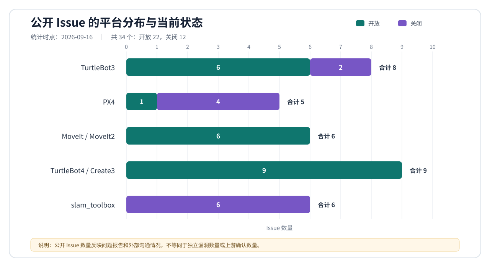

# 基于规范与语义反馈的 RoboFuzz 增强工作总结

## ——与《具身智能系统控制逻辑漏洞挖掘》开题报告的对齐分析

**总结范围：** 本报告只统计本人围绕 RoboFuzz 开展并能由源码、容器、日志、分析文档或公开 Issue 交叉验证的研究与工程工作，不把项目组其他成员的计划任务或尚无证据的成果计入个人完成情况。

**统计时点：** 2026 年 9 月 16 日。

**核查基线：** 开题报告 `/home/ymc/下载/2-开题报告 - 涛(1).doc`；原始 RoboFuzz 源码 `/home/ymc/llmfuzz/robofuzz/src`；Foxy 改进仓库 `/home/ymc/RoboFuzz`；Jazzy 扩展仓库 `/home/ymc/RoboFuzz-jazzy`；现存 Docker 镜像、容器、实验日志、复现材料和公开 GitHub Issue。

## 一、总体结论

开题报告提出三条相互衔接的技术路线：一是利用大语言模型从文档、配置、接口和运行机制中提取控制语义约束，构建行为 Oracle；二是结合路径结构与语义反馈生成、变异和调度测试输入，以激活高维稀疏状态空间中的漏洞路径；三是在仿真与实物环境中比较执行状态，完成控制语义偏轨判断、异常识别与溯源验证。本人现阶段的工作已经形成一条可运行的仿真侧链路：

`system_doc 原始规范 → 格式感知预处理 → SpecBlock 索引 → OracleIR → 目标相关可执行 Oracle → 语义种子与变异 → 多维反馈与队列调度 → 仿真实验 → 错误签名归并 → 回放取证 → 上游 Issue`。

这项工作与开题报告前两条路线高度一致，并完成了第三条路线中的仿真状态采集、独立真值对比、偏轨判定和回放取证。开题进度将 2025 年 12 月至 2026 年 12 月安排为“语义约束提取与行为 Oracle 构建”，2027 年安排为语义反馈驱动输入生成，2028 年安排为 Go2、ECO65-B 上的仿真—实物差分验证；目前实际工作已经延伸到第二阶段，并对第三阶段的仿真部分做了较充分预研。因此，当前成果不是只有设计文档，而是已经具备多目标执行能力、长轮次实验和公开问题报告的阶段性研究原型。

但现有成果也不能表述为“整个项目已经完成”。开题报告指定的 Unitree Go2 与 ECO65-B 实物平台尚未接入；仿真—实物状态差分尚未开展；四类输入中的专用传感器扰动仍较弱；“相对 RoboFuzz 控制语义约束覆盖率提升不少于 20%”尚缺同预算、同环境的严格消融实验；公开 Issue 也不能直接等同于独立漏洞，更未形成 CNVD/CNNVD 编号闭环。最准确的定位是：**前两条技术路线已经形成较完整的多平台仿真研究原型，第三条路线完成了仿真侧基础，最终验收所需的严格对照、实物验证和漏洞编号仍待补齐。**

## 二、与开题报告技术路线的总体对应

| 开题研究内容 | 已完成的本人工作 | 当前边界 |
| --- | --- | --- |
| 大语言模型语义约束提取与行为 Oracle 构建 | 建立多源规范库；实现八类格式的预处理与可追溯 SpecBlock；由 Agent 检索规范并生成 OracleIR；将结构化约束具体化为五类现代目标的运行时 Oracle | 已有通用 OracleIR 编译原型，但实验运行时仍加载目标专用 Python Oracle；Agent 与人工仍需处理话题可观测性、状态前置条件、窗口和噪声 |
| 路径结构与语义反馈驱动的扰动输入生成 | 将单点随机值扩展为持续、反转、耦合、边界和回环等行为序列；建立反馈到策略的映射；加入质量门控、错误签名、种子去重、容量限制和停滞恢复 | 用户指令、控制/规划参数和消息时序支持较强；IMU 连续扰动、LiDAR 点级删除和视觉趋势扰动等专用传感器输入仍未形成统一闭环 |
| 仿真—实物差分的漏洞判断与溯源 | 使用 rosbag、PX4 ULG、Gazebo 真值和任务结果完成仿真侧偏轨判定；支持 TurtleBot、PX4、MoveIt、SLAM 等目标的输入恢复和离线复算 | 当前是“仿真状态与规范/仿真真值”的比较，不是“仿真—实物差分”；尚无 Go2、ECO65-B 实物重复执行与安全验证 |

## 三、在原始 RoboFuzz 基础上的源码级改进

### 1. 先明确继承关系，避免把原有能力重复计为新增成果

原始源码 `/home/ymc/llmfuzz/robofuzz/src` 的当前核查提交为 `1176690`。它已经具备 AFL 风格的字段/类型变异、代码覆盖采集、单消息/序列/重复等 Campaign、PX4 与 MoveIt 适配、基础 checker/rosbag，以及 `INC`、`DEC`、`ZERO`、`TARGET` 四类反馈和向量高水位 `is_interesting()` 判断。因此，本人工作的创新点不能写成“首次为 RoboFuzz 加入反馈、序列或 PX4/MoveIt”，而应放在反馈的语义化、结果质量控制、种子生命周期治理和跨目标可追溯 Oracle 上。

| 机制 | 原始 RoboFuzz 已有能力 | 本人完成的主要增量 | 对项目研究的意义 |
| --- | --- | --- | --- |
| Oracle | 少量人工编写的不变量与目标特例 | 规范库、预处理、OracleIR、目标深层 Oracle、前置状态和时间窗口、跨话题一致性及任务级判定 | 把“程序是否崩溃”扩展为“控制行为是否偏离规范” |
| 反馈 | 四类方向反馈和高水位更新 | 目标相关连续指标、最小变化阈值、反馈—变异策略映射、数据质量门控和部分高水位保留策略 | 降低微小噪声和伪异常对搜索方向的劫持 |
| 种子队列 | 基于 `deque` 的先进先出与 interesting requeue | 容量 50、最多选择 5 次、新鲜度加权、陈旧淘汰、语义去重、崩溃污染清理、错误签名去重和停滞恢复 | 抑制长实验中的队列爆炸和同类错误反复入队 |
| 输入生成 | 通用字段级随机/确定性变异和基础序列 | 面向运动语义的持续、阶跃、反转、耦合、边界、轨迹弧、单点极值、回环等策略与目标种子 | 更容易形成加速度、jerk、漂移和状态切换所需的历史上下文 |
| 目标运行 | 目标差异散落在主循环和脚本中 | target profile、话题别名、Action/Topic 就绪检查、实际数据就绪、启动适配器和解析后元数据 | 将新目标接入收敛为可检查的“运行契约” |
| 证据保存 | 错误文本、覆盖和 rosbag | 输入/错误签名、JSON sidecar、ULG、质量摘要、真值对齐、离线复算与回放工具 | 支撑“触发—去重—复现—解释”的证据闭环 |

### 2. 两阶段代码演进

Foxy 仓库当前提交为 `b7465ed`，相对 `origin/master` 有 50 个提交、125 个文件发生变化。这个阶段完成了 TurtleBot3、PX4 v1.12 和 MoveIt 的深层 Oracle、语义序列、回放工具、规范预处理、OracleIR 框架、错误签名和质量感知种子队列。差异统计中包含大量参数 JSON、XML、规范文档和实验材料，因此不宜以“新增五万余行”作为核心贡献指标，真正有意义的是上述机制能否形成可复现实验结果。

Jazzy 仓库当前提交为 `de42800`，在 Foxy 提交 `b7465ed` 之后又有 31 个提交，目标依次扩展到 MoveIt2、TurtleBot4、PX4 v1.17、slam_toolbox 和 Nav2。该阶段不仅迁移到 Ubuntu 24.04、ROS 2 Jazzy 和 Gazebo Harmonic，还把 QoS、生命周期节点、Action 服务、ROS–GZ 桥接、独立真值、数据就绪条件和不同任务结束语义纳入运行框架。当前工作区仍有 Nav2、harness、seed generator、YAML 预处理和阈值设计等未提交修改，因此本报告反映的是“2026-09-16 工作区快照”，尚不是可直接复现实验的冻结发行版。

## 四、从规范到可执行 Oracle 的完整链路

### 1. 规范获取与预处理

规范材料不只包括自然语言说明，还包括参数参考、ROS 2 `msg/srv/action`、YAML、JSON/XML、Markdown 表格与正文、协议流程、源码片段、URDF/SDF/Xacro/SRDF 模型等。预处理流程针对八类格式完成递归发现、格式识别、分块、结构化归一、自然语言补充、引用保留、来源记录和 ID 去重，并输出 block 快照、索引和 manifest。现有五个现代目标共有 2749 个 SpecBlock：

| 目标 | SpecBlock 数 | OracleIR 数 | 内部质量评估 |
| --- | ---: | ---: | ---: |
| MoveIt2 Panda | 632 | 27 | 尚无同口径综合分 |
| TurtleBot4 Jazzy | 598 | 18 | 73.1 |
| PX4 v1.17 Jazzy | 561 | 26 | 59.8 |
| slam_toolbox Jazzy | 229 | 38 | 89.2 |
| Nav2 Jazzy | 729 | 42 | 63.5 |
| **合计** | **2749** | **151** | — |

此外，早期 PX4 路径保留 35 个 OracleIR 条目。上述综合分用于检查来源完整性、语义字段和逻辑结构，不是 Oracle 准确率；其中部分目标的“参数与观测绑定”维度明显偏低，说明自动生成的条目仍存在未解析参数、合成引用或运行映射不足，不能仅凭条目数判定约束已可执行。

### 2. OracleIR 与 Agent

OracleIR 明确表示观测量、参数、常量、派生变量、断言、适用 scope、时间窗口、反馈指标和 provenance。Agent 不是一次性把整份文档塞给模型生成代码，而是通过工具检索规范块和相似约束，生成候选 IR，经 schema/语义校验后保存；失败时能够根据校验信息继续修正。这一设计把“语言模型生成结论”转化为可检查的中间产物，使阈值来源、作用对象和约束逻辑可以分别审查。

当前代码中确实存在 `src_jazzy/oracle_ir/transform/compiler.py`，能够把 `every_sample`、`sequential_pairs` 和 `aggregation` 等窗口编译为内存中的 `CompiledOracle`。但必须准确区分“存在编译原型”和“长实验已经由 IR 自动执行”：运行时 `checker.py` 仍然静态导入 `oracles.turtlebot`、`oracles.px4`、`oracles.moveit`、`oracles.slam` 和 `oracles.nav2`，并未加载通用编译器。因此，当前真实流程是 **Agent 生成结构化 OracleIR，Agent 与人工结合目标上下文编写或修订目标 Oracle，再接入 RoboFuzz**，而不是完全无需人工的 IR-to-code 编译。

测试结果也支持这一边界判断：OracleIR 的 13 项单元测试全部通过；早期 PX4 的 35 个 IR 均能通过校验并构造 `CompiledOracle`，正常样本产生 0 个误报，但集成脚本注入速度违规后仍得到 0 个检出，脚本明确输出 `Violation: FAIL`。这说明 IR 结构和编译框架已经成型，观测绑定与执行语义尚未完全闭环。预处理测试当前为 16 项中 14 项通过，两个失败均与 TurtleBot4 控制器 YAML 中速度/加速度参数路径未按预期生成有关，也与 PX4/TB4 内部质量评估中参数绑定偏弱的现象一致。

### 3. 目标相关可执行 Oracle

真正用于实验的 Oracle 已覆盖多种非崩溃控制偏差。TurtleBot3/4 检查速度和加速度包络、差速运动学、命令路径与里程计关系、非平面运动和传感器一致性；PX4 检查速度、加速度、jerk、倾角、角速度、飞行状态、failsafe、控制模式和执行器状态；MoveIt 检查关节位置、速度、加速度、jerk、缩放因子、轨迹跟踪、末端误差和执行结果；SLAM 使用 Gazebo 独立真值计算窗口 RPE、ATE 与航向漂移；Nav2 检查 Action 结果、到达一致性、碰撞、卡滞和超时。质量门控会先确认飞行是否真正离地、机械臂是否有成功目标、SLAM 是否有足够样本且未碰撞、Nav2 目标是否具备合理可达性，再决定错误是否进入反馈和种子队列。

这种“结构化 IR + 目标上下文化 Oracle”的路线符合当前研究原型阶段，也解释了人工参与的必要性：同一个“速度不超过上限”约束，在不同目标中可能分别约束外部命令、控制器 setpoint、实际状态或带状态前置条件的持续窗口；若忽略这些差异，很容易把正常瞬态、采样差分或基础设施失败误报为漏洞。

## 五、语义输入、反馈与种子调度

当前 `mutation_profile.py` 定义了多轴协同、方向翻转、持续块、边界推进、反转、轨迹弧、单点极值和回环八类目标/领域语义策略，并保留随机策略作为探索兜底，因而开题报告“语义相关变异算子不少于 5 类”的数量要求已经有源码证据。MoveIt 调度器内部还实现了 perturb、swap、negate、replace、resize、orient、oscillate 等利用型操作，但这些是目标内的子操作，不宜与上述八类跨目标策略简单相加来放大算子数量。

种子从“单条消息的一个字段”扩展为能够表达行为演化的序列：TurtleBot3/4 使用阶跃、停止、连续反转和线角速度耦合；PX4 使用多轴 Offboard 速度、升降、偏航和方向切换；MoveIt 使用可达边界、多目标反向运动和规划缩放参数；SLAM 使用持续直线、原地旋转、圆弧和回环；Nav2 根据地图连通性、距离和障碍物 clearance 生成目标。反馈则不再只有“是否报错”，而是记录超限比、跟踪误差、姿态压力、真值漂移、样本质量、任务结果和持续时间等连续指标，并把反馈类型映射到更可能放大该指标的策略。

质量感知 `SeedQueue` 当前主要用于 PX4 v1.17、MoveIt 和 TurtleBot4；SLAM 另有专用质量门控与错误签名逻辑，其他旧目标仍保留原始 FIFO 路径。队列采用容量 50、单种子最多选择 5 次、新鲜度加权、陈旧淘汰和语义去重，并仅在出现新错误签名或有意义的反馈提升时重入队。Foxy MoveIt 长实验曾在 2192 轮后将队列膨胀到 11971，且新问题早已饱和；Jazzy 的队列上限、重复签名抑制和周期收敛正是针对这一问题形成的工程改进。

按开题报告的四类输入重新审视，当前完成度并不均衡。若沿用方案中的四维表示，可判断为：用户指令 `C_user` 支持较强，包括 `cmd_vel`、PX4 setpoint、MoveIt 位姿和 Nav2 Action goal；控制参数 `P_config` 已覆盖 PX4 参数和 MoveIt 速度/加速度 scaling、规划时间与容差，但还不是通用参数面；消息事件 `M_order` 已支持序列顺序、持续时间、频率、反转和部分状态/模式变化；传感器数据 `M_data` 目前更多作为 Oracle 观测量或通用 ROS 消息变异对象，尚未形成开题方案所设想的 IMU 连续扰动段、LiDAR 边缘/点删除、视觉趋势扰动及其统一反馈调度。因此，第 2 项指标只能判为部分达到。

## 六、运行框架、容器与可复现性

Jazzy 版本通过五个 target profile 管理 `turtlebot4_jazzy`、`px4_v117_jazzy`、`moveit2_jazzy`、`slam_toolbox_jazzy` 和 `nav2_jazzy`。profile 记录输入接口、必需/可选监控话题、话题别名、Action 服务、日志就绪标记、实际数据就绪、超时、启动适配器、Oracle 模块和输入模式，并在运行目录保存解析后的 profile 与 watchlist。这是一个重要但容易被漏洞数量掩盖的成果：它把“进程启动了”与“目标真的能接受输入、监控话题已有数据”分开，减少了把启动死锁、空 bag 或 Action 不可用当成目标异常的风险。

容器核查表明，`robofuzz:latest` 与官方 `ghcr.io/sslab-gatech/robofuzz:latest` 的镜像 ID 相同，是 2022 年的 32 GB Foxy 基础镜像。Foxy 的 `robofuzz_modified`、`px4_fuzz_modify` 和 `moveit_modify` 并不是另一份独立“改进镜像”，而是在同一镜像中绑定 `/home/ymc/RoboFuzz/src` 运行改进源码；原版容器则不挂载该源码。这个设计可以支撑同环境对比，但报告中应写成“同镜像、不同源码挂载/参数”，不能写成两个已版本化镜像。

`robofuzz-jazzy:latest` 是单独构建的现代环境镜像，当前 ID 为 `2f84b2…`、大小约 11.5 GB。TurtleBot4、PX4 v1.17、SLAM 和 Nav2 的代表性容器均把当前仓库挂载到 `/work`，因此实验结果同时依赖镜像和宿主提交/工作区状态。另有一个约 33.1 GB 的 `robofuzz_nav2:latest` 旧镜像，但当前 Nav2 长实验实际使用的是 `robofuzz-jazzy:latest`。最终冻结实验时必须同时记录镜像 digest、Git 提交、未提交补丁、profile 和运行命令，仅保存镜像标签不足以复现。

测试审计也显示当前仓库还不是“全量回归全绿”的发布版本。除前述 OracleIR 13/13 和预处理 14/16 外，直接在 Jazzy 镜像中运行全量 `src_jazzy/tests` 会遇到旧测试导入路径、Foxy URDF 路径和 MoveIt URDF 内容等环境/fixture 错误，同时仍有 Nav2 false-failure 和 SLAM requeue 记忆两个行为断言失败。它们不否定既有实验日志，但意味着交付前还需提供固定的容器内测试入口、依赖和测试数据，并修复真实断言回归，不能笼统宣称“全部测试通过”。

## 七、实验结果与实际解释

### 1. Foxy 阶段：方法形成与误报治理

TurtleBot3 的内部分析把 15 个表面异常归并为 10 个候选独立根因和 5 个级联表现，其中两个主要传播源是 Gazebo diff-drive 未按硬件速度限制钳位，以及 SDF 的 `max_wheel_torque=20 Nm` 与实际约 1.4 Nm 不匹配。分析文档进一步给出“原版 5 个、改进版 10 个独立候选”的对比。这可以作为深层 Oracle 揭示级联传播的内部证据，但其中“独立”和“真实”仍是项目内判定，不等同于维护者确认或漏洞编号。

PX4 v1.12 多轮实验促成了飞行阶段过滤、动态参数、ULG 取证、输入/错误签名和飞行质量门控。早期长跑曾因偏航、weathervane、ROS bridge 噪声和高频信号导致误报或反馈劫持，说明高动态系统中的 Oracle 必须包含控制模式、飞行阶段、时间窗口和独立日志证据。基于 v1.12 的 Issue 对发现方法有价值，但版本已经过旧，不能替代对当前 PX4 的验证。

MoveIt Foxy 长实验共记录 2192 轮、147 个 error 和 11971 个队列项。离线复算认为 120 个为同类 TOPP-RA 速度超限样本、1 个为规划位置越限，24 个端点异常中 22 个是目标/状态索引错位造成的误报，另有 2 个录制末态误报。最终主要收敛为两个候选根因族，而不是 121 个独立漏洞。该实验直接推动了端点语义修正、质量门控、错误签名和有界 SeedQueue。

### 2. Jazzy 阶段：现代软件栈与跨目标验证

| 目标与代表实验 | 可核实数据 | 经过归并后的解释 |
| --- | --- | --- |
| TurtleBot4 semantic3，1000 轮，容器正常退出 | 928 个错误轮次、842 个输入签名、781 个错误输入签名；输入均在保守速度包络内；odom 线/角加速度最高约 2.95×/2.33×，内部命令路径最高约 11.76×/6.62×。相对 p0p1 实验，唯一输入由 629 增至 842，最高重复签名由 156 次降至 21 次 | 证明语义种子显著提高输入多样性并保留高强度信号；928 次触发主要归入同一“加速度限制/命令路径”链及其下游里程计表现，不能写成 928 个漏洞。scan 空世界问题是观测覆盖限制，不是安全漏洞 |
| MoveIt2 Panda 修复后实验，手动停止于 247 次尝试 | 224 个 error 帧；166 帧触发绝对加速度约束，219 帧触发 scaling 语义，内部高可信分级 194 帧；最强 `desired.accelerations` 为声明软限值的 2.753×；二者共现率 97% | 主要是 TOPP-RA 时间参数化输出过激这一根因在“绝对限值”和“缩放契约”两个维度上的投影，不能因两个 Oracle 标签就机械计成两个完全独立根因；其中硬件安全上限与规划软限值也必须区分 |
| PX4 v1.17 refined，1000 轮，容器正常退出 | 1000 份 metadata、12 个 error/ULG、146 份反馈记录；输入位于保守 Offboard 白名单内；筛得 4 个同时具有持续倾角和实际角速度超限的高优先级候选 | 证据来自 PX4 内部 ULG，强于旧版 ROS bridge 数据；当前可称为 4 个高信号样本或一个/少数控制响应候选族，尚未完成稳定最小复现和 v1.17 上游报告 |
| slam_toolbox v6，容器正常退出但实际为 932 轮 | 19 个 error，其中 1 个是 publish 超时基础设施伪影；其余 18 个语义报警分为 7 强、5 中、7 边界（1 轮双标签）；离线复算未跌破阈值 | 主要归并为“旋转/急弧线下航向漂移”和“高速直线下相对位姿漂移”两个强/中候选族；弧线边界族贴近阈值，不宜独立主张。它们属于性能/语义偏轨候选，不是崩溃漏洞 |
| Nav2 当前长实验 `rf-nav2-long` | 容器表面运行四周，但 fuzzer 日志自 8 月 19 日停在 EXEC 71，共 72 份 metadata；目标 stdout 仍持续增长；进程约占 950%–990% CPU、1210 个 PID；仅有两个 `NAV2_ABORT_IN_INFLATION:info`，目标 clearance 0.4 m、低于 0.67 m 门槛 | 这是停滞/孤儿化的无效长跑，不是完成的 1000 轮实验；两个 abort 是近障碍目标的预期不可规划结果，不是 Nav2 漏洞。Nav2 当前成果应计为 profile、地图目标生成、Action 链路、真值与 Oracle 接入以及阈值校准 |

Foxy 容器中的部分原版、改进版和 MoveIt 容器以退出码 137 结束，PX4 原版/改进版以 0 结束；Jazzy 的 TB4、PX4 refined 和 SLAM v6 以 0 结束，部分早期 smoke/long 容器以 1 或 137 结束。退出码 137 只能说明进程被 SIGKILL（可能是人工停止、资源限制或 OOM），不能当作“实验正常完成”。实验是否完成应同时检查 maxloop 终止文本、metadata 数量、最后轮次、容器状态和日志完整性。

## 八、公开 Issue、漏洞候选与成果口径

截至统计时点，公开检索到本人创建的 Issue 共 34 个，22 个开放、12 个关闭。它们是重要的成果转化和外部沟通记录，但“提交数量”“错误样本数”“Oracle 标签数”“独立根因数”和“上游确认漏洞数”是五个不同口径，不能相互替代。

*图 1　各平台公开 Issue 的数量与当前状态。数据为 2026 年 9 月 16 日快照；Issue 数量反映问题报告和外部沟通情况，不等同于独立漏洞数或上游确认数。*

| 平台 | Issue 数与状态 | 更合理的根因归并 | 外部反馈与应有表述 |
| --- | --- | --- | --- |
| TurtleBot3 | 8：6 开放、2 关闭 | 内部文档把 15 个表面现象归为 10 个候选根因；公开报告实际集中在速度/加速度限制、仿真动力学、运动学与传感器一致性等少数链路 | 已有维护者/参与者指出部分问题在当前 Jazzy 不可复现、属于预期仿真物理行为或已在受支持版本修复。可称“候选与历史版本问题报告”，不能把内部 10 个全部计为上游确认 |
| PX4 | 5：1 开放、4 关闭 | v1.12 Offboard 输入边界、动态平滑、rate/attitude 响应与饱和级联存在重叠 | 唯一开放的 [#27611](https://github.com/PX4/PX4-Autopilot/issues/27611) 有 `kind:bug`/`scope:control` 标签，但仍是 v1.12 报告且处于 stale；多条关闭反馈明确指出 v1.12 过旧、不再支持。Jazzy/v1.17 的 4 个强样本尚未提交 |
| MoveIt/MoveIt2 | 6：全部开放 | 可大致归为时间参数化与关节限值/缩放、模型软限值、执行结果与末端语义三组；多个标题是同一链条的不同表现或不同仓库落点 | [#3778](https://github.com/moveit/moveit2/issues/3778) 等报告含清晰 reference trajectory 证据，但当前开放或带 bug 标签不等于维护者已确认根因；应继续提供最小请求、当前版本复现和与硬限值的准确区分 |
| TurtleBot4/Create3 | 9：全部开放 | 多数指向“安全外部命令—内部 command path—odom 加速度”这一主链，另有 scan 可观测性限制；跨 `turtlebot4_simulator` 与 `create3_sim` 的报告存在交叉 | [#102](https://github.com/turtlebot/turtlebot4_simulator/issues/102) 等负对照强化了输入合法性证据，但九条 Issue 不等于九个独立漏洞；应优先合并主报告、补充脱离 RoboFuzz 的最小回放和完整上游 launch 对照 |
| slam_toolbox | 6：全部关闭 | 实验内部主要只有旋转航向漂移、直线相对位姿漂移两个强候选族，另有边界弧线辅助族 | 多条报告被维护者以 AI-generated、duplicate 等理由关闭，未获得技术认可。这里的成果是“发现并复算性能偏轨候选、尝试上游沟通”，不能称为六个确认漏洞；后续报告必须减少模板化表达并提供单一、人工核实的最小复现 |
| **合计** | **34：22 开放、12 关闭** | 应按稳定复现与独立根因重新计数 | 本次核查未找到可与开题指标等价的 CNVD/CNNVD 编号或已合入修复证据 |

建议以后采用五级证据链管理成果：A 级为源码功能已实现并有测试；B 级为实验中出现 Oracle 命中；C 级为离线复算和独立重放后仍能稳定复现，并完成级联去重；D 级为已向上游提交完整 Issue；E 级为维护者确认、修复合入或获得 CNVD/CNNVD。当前工作在 A–D 级积累较丰富，但不同候选所处级别不同，E 级证据仍不足。项目汇报可以同时给出“实验命中数、稳定候选族、公开报告数”，但不能再用一个“发现 Bug 数”混合表达三者。

## 九、开题报告六项指标逐项判断

开题报告明确规定，指标 1–5 通过实验室环境中的原型系统验证，指标 6 则要通过实验室实物平台模糊测试并申请未公开漏洞编号验证。因此，仿真结果可以支撑前五项的方法与性能证据，却不能用来替代第 6 项的实物和编号要求。

| 开题指标 | 当前可核实证据 | 完成判断 |
| --- | --- | --- |
| 1. 提取控制语义约束不少于 50 条 | 五个现代目标有 151 个 OracleIR，另保留 35 个早期 PX4 IR；规模明显超过 50。部分条目仍存在参数绑定不足，且并非全部接入运行时 | **规模达到，验收清单待固化**。需输出去重后的“规范来源—IR—可执行检查—实验命中”映射，区分候选 IR 与有效约束 |
| 2. 输入包含用户指令、传感器数据、控制参数和消息事件四类 | 用户指令、规划/控制参数、行为序列及时序事件已有较强实现；传感器主要用于观测，专用连续/结构化注入不足 | **部分达到**。补齐 IMU、LiDAR、视觉等至少一种可控专用扰动，并纳入统一调度后才能完整达标 |
| 3. 语义相关变异算子不少于 5 类 | 源码可核实八类领域语义策略，另有随机兜底；各目标还有若干内部操作 | **已达到** |
| 4. 支持控制语义偏轨判定与场景回溯 | 五类现代目标有运行时 Oracle；TurtleBot、PX4、MoveIt、SLAM 有 rosbag/ULG、输入恢复、离线复算或回放材料 | **仿真侧达到**。实物场景回放与虚实对齐尚未完成 |
| 5. 相比 RoboFuzz，控制语义约束覆盖率提升不少于 20% | TurtleBot3 有“触发类型 2→12”、TB4 有 p0p1/semantic3 多样性数据，但实验同时改变 Oracle、种子、调度和平台；“触发类型数”也不是正式定义的约束覆盖率 | **尚未形成达标证据**。必须先定义分母，再做同目标、同预算、同场景的原版/消融/完整版对照 |
| 6. 至少两类典型平台发现未公开漏洞不少于 5 个，并获得 CNVD/CNNVD 编号 | 已覆盖移动机器人、无人机、机械臂、SLAM/Nav2 软件栈，并形成 34 个公开 Issue 和若干稳定候选族 | **尚未达到验收口径**。当前以仿真为主，独立根因与上游确认仍需收敛，无实物验证和 CNVD/CNNVD 编号 |

因此，不能把六项指标写成“全部完成”。更准确的阶段判断是：第 1、3 项已有直接数量证据；第 4 项完成仿真侧功能；第 2 项已完成三类强支持而传感器注入待补；第 5 项有明显提升迹象但没有符合指标定义的实验；第 6 项有多平台候选和公开沟通，却尚未满足实物与编号要求。

开题要求的成果形式中，“基于模糊测试的控制逻辑漏洞挖掘原型系统和相关文档”已经具备阶段性交付基础，且覆盖漏洞定义、模糊测试和仿真验证三个模块。本报告及各目标分析可作为《具身智能系统控制逻辑漏洞挖掘技术》研究报告中“RoboFuzz 增强方法与实验”部分的素材。专利 2 项、论文 2 篇属于项目总体验收成果，本次个人工作区核查没有发现可确认的申请或发表记录，因而不列为已完成。

## 十、本人可归属的主要贡献与尚存差距

本人工作的核心贡献不是简单增加若干 if 判断，而是围绕开题提出的三个难题，把原始 RoboFuzz 推进为一个规范驱动、语义反馈引导、能够形成多源证据的多目标仿真原型。可归纳为四项：建立异构规范到 SpecBlock、OracleIR 和目标 Oracle 的可追溯链路；把行为序列、连续反馈、质量门控和有界 SeedQueue 连接成搜索闭环；完成 Foxy 到 Jazzy 的跨版本迁移及 TurtleBot4、PX4 v1.17、MoveIt2、SLAM、Nav2 扩展；建立错误签名、真值/ULG 证据、回放复算和上游报告流程，并在实验中主动识别误报、级联和饱和。

同时，需保留清晰的归属边界。反馈类型、高水位判断、通用消息变异、Campaign、基础 checker 以及早期 PX4/MoveIt 支持来自原始 RoboFuzz；本人贡献是对这些机制做语义化和目标化扩展。Unitree Go2 当前只有 OracleIR target descriptor 骨架，没有 target profile、运行时适配或实验；ECO65-B 尚未接入，因此不能把“可扩展设计”写成“指定平台已完成”。原始和 Jazzy 仓库中的大体量文档/参数文件也不应折算为算法工作量。

当前最需要正视的工程差距有三类。第一，IR 编译器尚未成为实验运行时的唯一执行路径，且注入违规集成测试未检出；第二，工作区、镜像和日志之间尚未形成不可变实验清单，全量测试入口也未收敛；第三，部分公开 Issue 过度拆分同一根因、使用旧版本或模板化表达，导致维护者关闭或降低信任。这些问题不会抹去已经完成的研究工作，但直接决定成果能否从“有效原型”升级为“可验收系统”。

与开题研究方案的细化设计相比，还有几项尚未落地或仅有局部实现：DSL/OracleIR 冲突处理所设想的优先级矩阵尚未形成；基于 GzFuzz 思路的环境自动生成与场景变异没有进入当前主实验；面向网络、加解密、协议和驱动层的测试没有形成可运行模块；Go2 descriptor 也只是目标描述骨架。这些内容应列为项目总体路线中的待办，而不能由现有 ROS 2 消息与控制语义实验代替。

## 十一、下一阶段优先工作

后续不宜再把主要精力放在增加运行轮数或 Issue 数量，而应集中完成五个闭环。

第一，冻结证据与版本。为每个代表实验记录 Git 提交、未提交补丁哈希、镜像 digest、target profile、规范快照、Oracle 版本、启动命令、随机种子和日志索引；将当前被忽略的报告与关键生成物纳入明确的成果归档。先结束或隔离已停滞的 Nav2 长实验，再用修复后的 clearance 门控和资源上限重跑。

第二，完成严格对照和消融。至少选择 TurtleBot4 与 MoveIt/PX4 中一个目标，在同一镜像、同一场景、同一时间或执行预算下比较：原始 RoboFuzz、仅增加 Oracle、Oracle+语义种子、完整反馈调度。可先把“控制语义约束覆盖率”固定为“获得有效观测并实际完成求值的可执行约束数 ÷ 本轮启用的可执行约束总数”，另行报告违反约束数和独立错误签名，避免把“错误类型更多”误称为“覆盖率更高”；再统计稳定候选族和单位时间首次发现数，以正式回答第 5 项 20% 提升指标。

第三，收拢 Oracle 自动化。先限定范围约束、变化率约束、顺序样本约束、聚合窗口和跨话题一致性五类模板，修复 PX4 注入违规 0 检出和 TB4 YAML 参数绑定测试，使一部分 IR 可以确定性编译并直接在 checker 中运行；复杂状态机和任务语义继续保留 Agent+人工后端。这样既提高自动化程度，也避免宣称一个尚未完成的“万能编译器”。

第四，补齐输入与实物路线。实现至少一种 IMU 连续片段扰动和一种 LiDAR/点云结构扰动，与现有用户指令、控制参数和事件序列共同进入反馈调度；随后按开题对象接入 Go2，再接入 ECO65-B 或经项目组确认的机械臂实物，设计安全限幅、急停、外部真值和重复执行流程，真正开展仿真—实物差分。

第五，收敛漏洞候选和外部沟通。每个平台只保留一至三个根因最清楚的候选，优先选择输入在合法范围、当前受支持版本可复现、正常对照明确且能够脱离 RoboFuzz 最小重放的样本。Issue 应由人工逐句核实，合并同一根因的多种表象，明确“规范契约违例、性能退化、仿真限制或安全漏洞”的类别，再根据厂商确认与影响决定 CNVD/CNNVD 申请。这个过程比继续堆积 34 以上的 Issue 更能直接支撑开题第 6 项指标。

## 十二、总结

综合开题报告、源码增量、容器状态、实验日志和公开 Issue，本人已经完成了一个有明确研究主线的阶段性成果：以异构规范和 OracleIR 回答“正确行为如何定义”，以语义序列、多维反馈和种子治理回答“稀疏漏洞路径如何触发”，以 rosbag/ULG/独立真值、错误签名和回放分析回答“非崩溃控制偏差如何验证和解释”。这些工作覆盖移动机器人、无人机、机械臂以及 SLAM/Nav2 软件栈，明显超出了在原始 RoboFuzz 上追加少量规则的范围。

同时，本次深入核查纠正了几项容易高估的表述：反馈与序列并非从零创建；OracleIR 编译器尚未接入实际长实验运行时；928 个错误轮次、194 个高可信帧或 34 个 Issue 都不是独立漏洞数；Nav2 长容器“仍在运行”不等于实验仍在有效推进；SLAM 等上游关闭记录也不能视为外部确认。经过这些修正，报告对成果的评价反而更加稳固：**已经完成的是一个能够运行、发现候选、去重和取证的多平台仿真研究原型；尚待完成的是统一覆盖指标、确定性 IR 执行、四类输入闭环、指定实物平台验证和正式漏洞编号。**

这一定位与开题报告的时间安排和技术路线相符，也为中期检查提供了清晰口径：既能说明本人已经实质推进到第二阶段并积累了多平台实验成果，又不会把内部候选、公开沟通或尚未完成的自动化能力包装成最终验收结果。

## 附：主要证据位置

- 开题报告：`/home/ymc/下载/2-开题报告 - 涛(1).doc`
- 原始 RoboFuzz 基线：`/home/ymc/llmfuzz/robofuzz/src`
- Foxy 改进仓库与证据：`/home/ymc/RoboFuzz`、`/home/ymc/RoboFuzz/analysis/bug and issue/evidence`
- Jazzy 总体说明：`/home/ymc/RoboFuzz-jazzy/README.md`
- 规范与预处理：`/home/ymc/RoboFuzz-jazzy/system_doc`
- OracleIR、Agent 与编译原型：`/home/ymc/RoboFuzz-jazzy/src/oracle_ir`、`/home/ymc/RoboFuzz-jazzy/src_jazzy/oracle_ir`
- 运行时 Oracle、反馈与调度：`/home/ymc/RoboFuzz-jazzy/src_jazzy/oracles`、`src_jazzy/fuzzer.py`、`src_jazzy/mutation_profile.py`
- 目标运行契约：`/home/ymc/RoboFuzz-jazzy/target_profiles`、`src_jazzy/target_profiles.py`
- TurtleBot4 分析：`docs/experiments/tb4_semantic3_1000_analysis.md`
- PX4 v1.17 分析：`docs/experiments/px4_v117_refined_1000_analysis.md`
- MoveIt2 分析：`docs/reports/2026-06-25-moveit2-unlock-1000-round2-postfix-analysis.md`
- slam_toolbox 分析：`docs/reports/2026-08-03-slam-toolbox-v6-1000round-bug-analysis.md`
- Nav2 阶段材料：`docs/issues/2026-08-05-nav2-jazzy-final-status.md`、`docs/issues/2026-08-06-nav2-closeout.md`
- 公开 Issue 汇总：[本人创建的 GitHub Issues](https://github.com/issues?q=is%3Aissue+author%3A147258369ymc)
